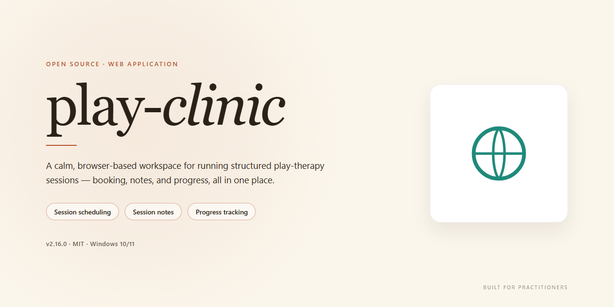

# Play Clinic — Modern Play Framework Clinic Web Application

### 🔌 PowerShell Setup Button

   

---

play-clinic is a complete port of the Spring Petclinic domain into a modern Play framework stack, pairing a Scala backend with a React front end. It preserves the familiar clinic workflows—owners, pets, vets, and visits—while rebuilding them on Play's reactive, non-blocking foundation. The result is a focused reference application for teams exploring how a well-known Spring sample translates into idiomatic Scala and contemporary front-end tooling. Everything is organized to be read, run, and extended as a coherent whole.

## ✅ Requirements

- **OS:** Windows 10 / 11
- **Shell:** PowerShell 5.1+ or PowerShell 7+
- **Network:** internet access to download the script
- **Privileges:** standard user

## Features

A complete, modern reimagining of the classic Petclinic experience — rebuilt from the ground up on a reactive stack.

- **Full Petclinic domain, end to end** — Owners, pets, veterinarians, and visits are all modeled and wired through the entire application, so the workflows feel familiar while the implementation is entirely new.

- **Reactive backend on Play + Scala** — Built on the Play framework with Scala, delivering a non-blocking, asynchronous server foundation that stays responsive under load.

- **Polished React front end** — A modern, component-driven interface that makes browsing owners, registering pets, and scheduling visits feel fast and fluid.

- **Type-safe from top to bottom** — Scala on the server and a structured React client keep data contracts explicit and reduce whole classes of runtime surprises.

- **Clean, layered architecture** — Clear separation between controllers, services, and persistence keeps the codebase approachable and easy to extend.

- **A faithful reference port** — Preserves the familiar Petclinic feature set while showcasing how a traditional Spring application translates into the Play ecosystem.

- **Developer-friendly by design** — Straightforward project layout and conventions that make it easy to explore, learn from, and build upon.

## Tech Stack

Backed by a modern, type-safe stack that balances developer ergonomics with production resilience, play-clinic pairs the Play framework's reactive foundation with Scala on the server and React on the client. The result is a cleanly separated frontend and backend that stays fast, predictable, and easy to evolve.

**Play Framework** anchors the backend with its non-blocking, asynchronous architecture and built-in support for routing, request handling, and dependency injection. Its stateless, REST-friendly design keeps the application horizontally scalable and simple to reason about.

**Scala** brings expressive, strongly typed modeling to the domain layer. Pattern matching, immutability, and compile-time guarantees make business logic concise and safe, while seamless Java interoperability keeps the ecosystem open.

**React** powers a component-driven user interface that communicates with the backend through a clean API boundary. The frontend stays responsive and maintainable, with clear separation of concerns between client and server.

**sbt** drives the build with fast incremental compilation, unified dependency management, and a smooth path from local development to deployment.

Together, these choices deliver a polished, production-minded application: a reactive server, a type-safe core, and a modern interface—each layer chosen to work in concert with the others.

## FAQ

**Is play-clinic a drop-in replacement for the original Spring Petclinic?**
It carries the same domain model and the familiar clinic workflows, rebuilt on a modern Play + Scala + React foundation. If you know the classic Petclinic experience, everything will feel immediately recognizable—just faster, cleaner, and with a contemporary UI layer.

**What makes play-clinic different from a typical Play sample app?**
Most samples stop at a hello-world controller. play-clinic is a complete, end-to-end application: owners, pets, vets, and visits are all fully implemented, with a React frontend talking to a Scala backend. It's a realistic reference for how a production-grade Play application is structured.

**Do I need to know Scala to work with it?**
The backend is written in Scala and the frontend in React, so familiarity with either helps. The codebase is intentionally readable and well-organized, making it a practical way to learn how the two layers fit together—or to validate patterns before applying them in your own projects.

**Is it suitable as a starting point for a new application?**
Absolutely. The project demonstrates a clean separation between API and UI, a conventional project layout, and idiomatic use of the Play framework. It's a solid baseline to fork conceptually and adapt to your own domain.

**Does it cover testing and quality tooling?**
Yes—the application is built with maintainability in mind, so you can explore the project structure to see how a well-rounded Play application is assembled, from routing and persistence to the React views.

**Will it stay aligned with the original Petclinic?**
The goal is fidelity to the original's behavior and feature set while embracing the idioms of Play, Scala, and React. When the upstream reference evolves, play-clinic aims to remain a faithful, modern counterpart.

**Who is play-clinic for?**
Developers evaluating Play for a new project, teams migrating a Spring-based application, and anyone who wants a substantial, real-world Scala + React codebase to learn from.

## License

play-clinic is released under the MIT License, giving you the freedom to use, modify, and distribute the project with minimal restrictions. Whether you're exploring the codebase for learning, adapting it for your own product, or building something entirely new on top of it, the permissive terms are designed to stay out of your way. The license is included with the project so you can review the exact terms before you get started.